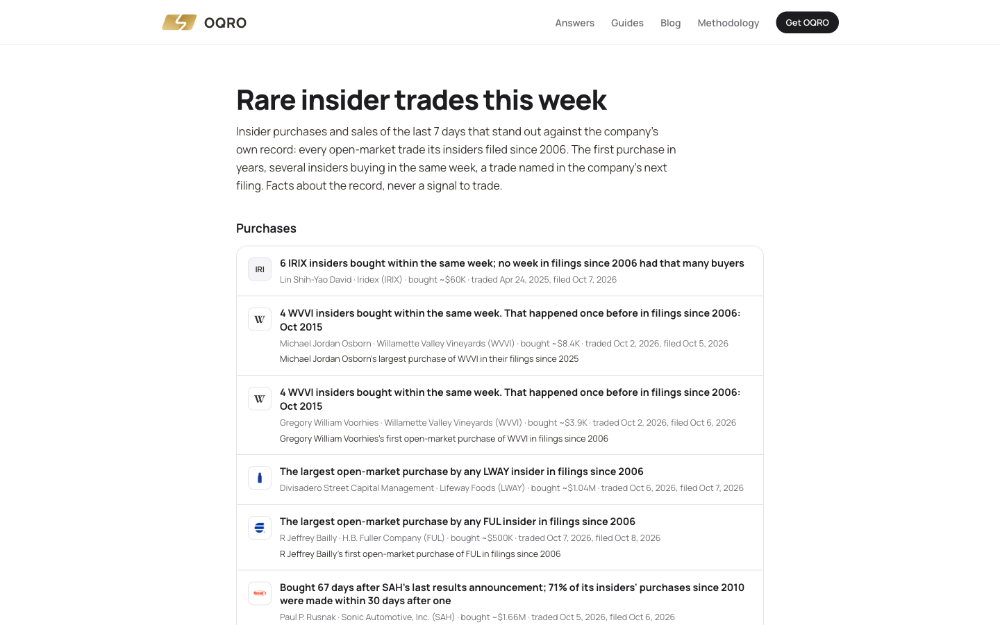

<h1 align="center">OQRO</h1>

<b>Follow the insiders. Understand the story behind every move.</b>

OQRO reads the US public record on every listed company and explains each disclosure in plain words, next to the official filing it came from: **insider trades (SEC Forms 4, 5 and 144), stock trades by members of Congress, hedge fund holdings (13F), 5% stakes (13D and 13G), federal contracts, lobbying and Form 8-K events.**

It covers more than 4,900 US-listed companies. It describes what was filed. It is not investment advice.

**Website: <https://oqro.io>**

## What makes it different

Every insider trade is placed against that company's own record since 2006 (about 1.6 million open-market trades from SEC data). A purchase is flagged when it stands out: the first by any insider in years, the largest ever for the company, several insiders buying in the same week, or a purchase shortly before an 8-K or results. Each flag is a plain sentence with the filing behind it.

## Free, no account

- [Rare insider trades this week](https://oqro.io/rare-insider-trades)
- [Weekly recap of insider and Congress trades](https://oqro.io/weekly) (one page per week since October 2024)
- [Every company page](https://oqro.io/stocks/AAPL) shows one real filing and the counts of the last 12 months
- [Insider trades day by day](https://oqro.io/daily), [biggest insider buys](https://oqro.io/insiders/biggest-buys), [politician trades](https://oqro.io/political), [fund moves](https://oqro.io/institutions)
- [Guides and answers](https://oqro.io/answers): how to read a Form 4, what a 13F shows, and more
- [Methodology](https://oqro.io/methodology), [coverage in numbers](https://oqro.io/coverage), [live status of each data source](https://oqro.io/status)

## OQRO Pro

$9.99 a month or $79.99 a year. Full records per company and insider, the screener, watchlist and alerts, Congress trades, fund moves, a daily brief and "Ask OQRO", an assistant that answers from the records with a link to each source. Pricing: <https://oqro.io/#pricing>.

## For developers

| | |
|---|---|
| **REST API** | Read-only JSON, base URL `https://oqro.io/api/v1`. See [docs/rest-api.md](docs/rest-api.md) and <https://oqro.io/docs/api>. |
| **MCP server** | Use the same data from Claude, ChatGPT, Cursor or any MCP client: [LdwS123/oqro-mcp](https://github.com/LdwS123/oqro-mcp) (also in the official MCP Registry as `io.github.LdwS123/oqro`). |
| **llms.txt** | <https://oqro.io/llms.txt> describes the site for AI assistants. |

Both the API and the MCP server are part of OQRO Pro.

## Data sources

SEC EDGAR (Forms 3, 4, 5, 144, 13F, 13D/13G, 8-K and the insider transactions data sets), House Clerk and Senate eFD periodic transaction reports, USAspending.gov, Lobbying Disclosure Act reports (lda.gov), FINRA short interest. Every record links to its source document. Amounts that are filed as ranges stay ranges.

## Follow OQRO

- X: [@oqrofinance](https://x.com/oqrofinance)
- LinkedIn: [OQRO](https://www.linkedin.com/company/oqro/)
- Instagram: [@oqro.io](https://www.instagram.com/oqro.io/)

## About this repository

This is the public home of OQRO's documentation and brand assets. The application itself is not open source. The files here are MIT licensed; the OQRO service, its data and its logo are covered by <https://oqro.io/terms>.
